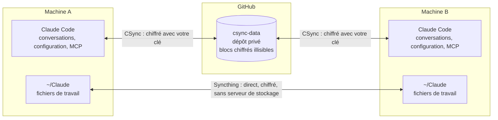
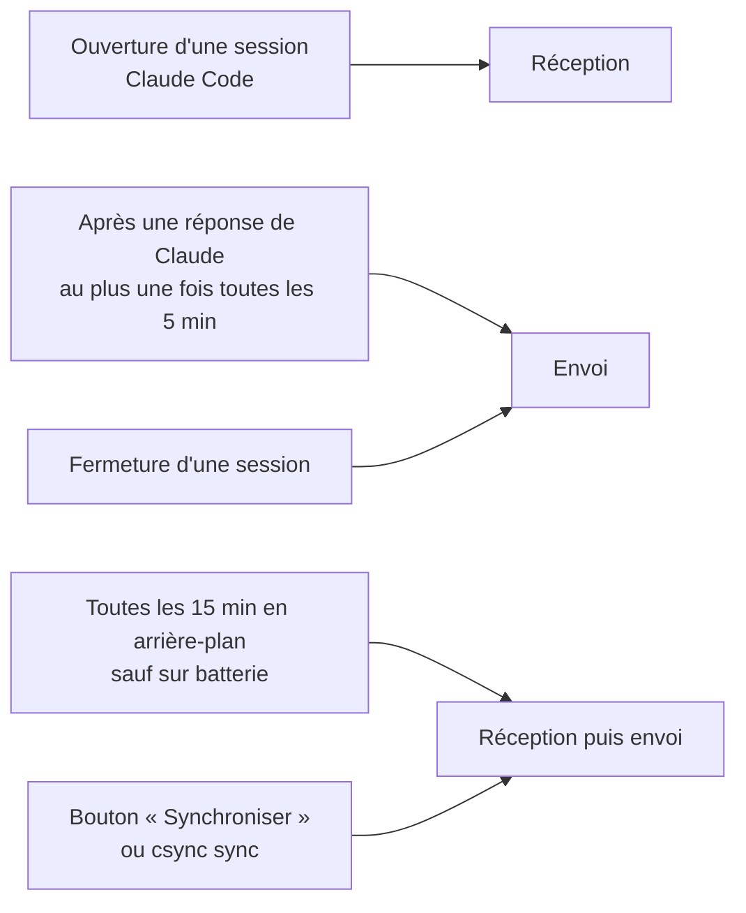

<div align="center">

# CSync

**Commencez une conversation Claude Code sur une machine. Reprenez-la sur une autre.**

Conversations, configuration, serveurs MCP et fichiers de travail, synchronisés entre vos machines.<br>
Chiffré de bout en bout. Automatique. Sans service tiers qui lit vos données.


[En bref](#en-bref) ·
[Comment ça marche](#comment-ça-marche) ·
[Installation](#installation) ·
[Au quotidien](#au-quotidien) ·
[Commandes](#les-commandes) ·
[Sécurité](#sécurité-de-vos-données) ·
[FAQ](#questions-fréquentes)

</div>

---

## En bref

Claude Code garde tout sur la machine où vous l'utilisez. Si vous avez deux machines (un MacBook et un Mac de bureau, un Mac et un serveur Linux), vos conversations, vos réglages et vos skills restent bloqués sur l'une des deux.

CSync les relie :

```sh
# Sur le MacBook, vous discutez avec Claude Code, puis vous fermez l'ordinateur.

# Plus tard, sur l'autre machine :
csync resume        # récupère les nouveautés, puis rouvre la conversation là où elle en était
```

Il n'y a rien d'autre à faire au quotidien. CSync envoie et reçoit tout seul, à l'ouverture et à la fermeture de chaque session Claude Code, et toutes les 15 minutes en arrière-plan.

### Ce que CSync synchronise

| Quoi | Détail | Par où ça passe |
|---|---|---|
| **Les conversations** | Tout `~/.claude/projects/`, avec les sous-agents et la mémoire automatique des projets | Dépôt GitHub privé, chiffré |
| **La configuration** | `CLAUDE.md`, `settings.json`, `keybindings.json`, skills, agents, commandes, styles de sortie, règles, workflows, thèmes, hooks | Dépôt GitHub privé, chiffré |
| **Les serveurs MCP personnels** | La clé `mcpServers` de `~/.claude.json`, et rien d'autre de ce fichier | Dépôt GitHub privé, chiffré |
| **Les plugins** | La liste des plugins activés voyage dans `settings.json` ; Claude Code télécharge ce qui manque | Dépôt GitHub privé, chiffré |
| **La barre latérale de l'app Claude** | Une conversation reçue apparaît dans l'onglet Code, sous son dossier | Dépôt GitHub privé, chiffré |
| **Les fichiers de travail** | Tout le dossier `~/Claude` (en option, avec `csync files setup`) | Syncthing, en direct entre les machines |

### Ce que CSync ne touche jamais

- **Votre connexion** : `~/.claude/.credentials.json`, le reste de `~/.claude.json`, le trousseau macOS.
- **Le code de vos projets** : chacun garde son propre dépôt git (sauf s'il est rangé dans un dossier partagé par `csync files`).
- **Les skills et plugins de votre compte claude.ai** (`skills/synced/`) : Claude Code les gère déjà.
- **Les fichiers de plus de 50 Mo.**
- **Les hooks de CSync eux-mêmes** : chaque machine garde les siens.
- **Ce que vous déclarez propre à une machine** (voir [Réglages propres à une machine](#réglages-propres-à-une-machine)).
- **Les liens symboliques** : CSync vous les signale. Seul le dossier des conversations peut être un lien vers un autre disque.
- **Les fichiers de fonctionnement** que des scripts écrivent dans les dossiers de configuration : journaux `.log`, bases `.db`, verrous, dossiers `logs/`, `cache/`, `tmp/`, `state/`.

---

## Comment ça marche

CSync utilise deux chemins séparés. Les conversations et la configuration passent par un dépôt GitHub privé, où tout est chiffré. Les fichiers de travail passent directement d'une machine à l'autre avec Syncthing.



### Le chemin des conversations : GitHub, chiffré

1. **Avant l'envoi, tout est chiffré** sur votre machine (AES-256-GCM) avec une clé qui ne quitte jamais vos machines.
2. **GitHub ne stocke que des blocs illisibles.** Les commits portent tous le même auteur (`csync`), le même message et une heure en temps universel.
3. **L'autre machine déchiffre** avec la même clé, que vous lui avez donnée vous-même à l'installation.

Les envois sont légers. Une conversation est découpée en tranches, et un ajout n'envoie que les nouvelles tranches. La configuration ne part que si elle a changé.

### Le chemin des fichiers : Syncthing, en direct

CSync ne transporte pas lui-même vos fichiers. La commande `csync files setup` installe [Syncthing](https://syncthing.net), un logiciel libre et gratuit, et le configure pour vous.

- Chaque machine publie son identifiant Syncthing dans le dépôt chiffré. À la synchronisation suivante, les machines se relient toutes seules.
- Les fichiers vont directement d'une machine à l'autre, chiffrés pendant le trajet. Ils ne sont stockés sur aucun serveur.
- Les deux machines doivent être allumées en même temps pour échanger. Sinon, le rattrapage se fait dès qu'elles se retrouvent.

Les détails sont dans [Les fichiers de travail](#les-fichiers-de-travail) et dans la [FAQ](#questions-fréquentes).

### Quand la synchronisation se déclenche



### Comment CSync retrouve vos projets d'une machine à l'autre

Claude Code range chaque conversation sous le chemin du dossier où elle a eu lieu. Ce chemin diffère souvent d'une machine à l'autre. CSync réécrit donc les chemins à l'envoi, puis à la réception.

- **Projet git** : il est reconnu partout grâce à l'adresse de son dépôt distant, même s'il n'est pas rangé au même endroit sur les deux machines.
- **Dossier sans git, dans votre dossier personnel** : il est reconnu s'il est rangé au même endroit sur l'autre machine. S'il n'y existe pas encore, CSync le crée (vide) en recevant la conversation, ainsi que le dernier dossier où elle s'est poursuivie. Sans ce dossier, Claude Code ne proposerait pas la conversation à la reprise. `csync status` liste les dossiers créés dans la semaine.
- **Projet git absent** : il n'est jamais remplacé par un dossier vide. La conversation attend (voir [Sessions en attente](#sessions-en-attente)).
- **Dossier situé ailleurs** (disque externe, `/var/www`…) : il n'est jamais partagé d'office, car deux dossiers de même nom peuvent n'avoir aucun rapport. Pour le partager, donnez-lui le même nom sur les deux machines avec `csync name-project`.

Quand l'autre machine annonce un projet inconnu ici, CSync le cherche dans votre dossier personnel. Il ne le fait jamais pendant un hook, et au plus une fois par jour pour un même projet. Sur Mac, les dossiers protégés (Bureau, Documents, Téléchargements) ne sont examinés que lors d'une action de votre part, jamais par la tâche de fond. Vous ne recevez donc pas de demande d'autorisation inattendue.

---

## Installation

Comptez une vingtaine de minutes pour deux machines. Dans ce qui suit, la **première machine** est celle qui a déjà vos conversations (un Mac dans les exemples). La **deuxième machine** peut être un autre Mac ou un serveur Linux.

Remplacez `VOUS` par votre nom d'utilisateur GitHub, `UTILISATEUR` par votre nom d'utilisateur sur la deuxième machine et `SERVEUR` par son adresse. Les commandes se tapent dans le Terminal (Mac) ou dans une session SSH (serveur).

### Vue d'ensemble

| Étape | Où | Ce que vous faites |
|---|---|---|
| 1 | GitHub | Créer deux dépôts : `CSync` (le code) et `csync-data` (vos données, privé) |
| 2 | Première machine | Mettre le code dans le dépôt `CSync` |
| 3 | Première machine | Créer une clé d'accès à `csync-data` |
| 4 | Première machine | Installer CSync |
| 5 | Première machine | Ranger la clé de chiffrement en lieu sûr |
| 6 | Deuxième machine | Créer sa propre clé d'accès à `csync-data` |
| 7 | Les deux | Copier la clé de chiffrement sur la deuxième machine |
| 8 | Deuxième machine | Installer CSync |
| 9 | Les deux | Vérifier |
| 10 | Les deux | En option : synchroniser aussi les fichiers |

### Ce qu'il faut avoir

- **Sur un Mac** : `git` et `python3` (3.9 ou plus récent). S'ils manquent, `xcode-select --install` les installe tous les deux.
- **Sur un serveur Linux** : `git`, `python3` (3.9 ou plus) et le module `venv`. Sur Debian ou Ubuntu : `sudo apt install git python3 python3-venv`.
- **Claude Code** installé sur les deux machines. CSync fonctionne sans, mais ses hooks ne servent qu'avec lui.

### Étape 1 : créer les deux dépôts sur GitHub

Sur github.com, menu en haut à droite, « New repository » :

1. **`CSync`**, le code de l'outil. Il peut être **public** : il ne contient aucun secret ni aucune donnée personnelle.
2. **`csync-data`**, vos données. Il doit être **privé**. Ne cochez rien (ni README, ni .gitignore, ni licence) ; un README seul est toléré. Ne vous en servez pour rien d'autre.

### Étape 2 : mettre le code dans le dépôt `CSync`

Décompressez `CSync.zip`, puis, depuis le dossier obtenu :

```sh
cd ~/Downloads/CSync          # là où se trouve le dossier décompressé
git init
git add -A
git commit -m "CSync"
git branch -M main
git remote add origin https://github.com/VOUS/CSync.git
git push -u origin main
```

Git vous demandera de vous identifier auprès de GitHub comme pour vos autres dépôts. S'il répond « Please tell me who you are », indiquez-lui une fois pour toutes votre nom et votre adresse avec `git config --global user.name "…"` et `git config --global user.email "…"`, puis relancez `git commit`. À défaut, la page du dépôt propose « uploading an existing file » : glissez-y le contenu du dossier.

### Étape 3 : donner à la première machine l'accès à `csync-data`

CSync travaille aussi en arrière-plan, sans personne pour taper un mot de passe. Il lui faut donc une **clé de déploiement** : une clé SSH (une paire de fichiers qui sert de badge d'accès) qui n'ouvre que `csync-data`, et rien d'autre de votre compte.

1. Créez la clé (laissez la phrase de passe vide : appuyez deux fois sur Entrée) :
   ```sh
   ssh-keygen -t ed25519 -f ~/.ssh/csync_deploy -C "csync mac"
   ```
2. Copiez sa partie publique :
   ```sh
   pbcopy < ~/.ssh/csync_deploy.pub
   ```
3. Sur GitHub, dépôt `csync-data` → « Settings » → « Deploy keys » → « Add deploy key ». Titre : `mac`. Collez la clé dans « Key », **cochez « Allow write access »**, puis « Add key ».
4. Indiquez à SSH d'utiliser cette clé pour `csync-data`, sous un nom dédié (`github.com-csync`) qui ne touche pas à vos autres accès GitHub. Ouvrez le fichier de réglages de SSH avec `nano ~/.ssh/config` (il est créé s'il n'existe pas), ajoutez ces lignes à la fin, puis enregistrez (Ctrl+O, Entrée) et quittez (Ctrl+X) :
   ```
   Host github.com-csync
       HostName github.com
       User git
       IdentityFile ~/.ssh/csync_deploy
       IdentitiesOnly yes
   ```
5. Vérifiez, et répondez `yes` si SSH demande de confirmer l'identité de github.com :
   ```sh
   ssh -T git@github.com-csync
   ```
   La réponse doit commencer par « Hi » et indiquer « You've successfully authenticated ».

### Étape 4 : installer CSync sur la première machine

```sh
git clone https://github.com/VOUS/CSync.git ~/CSync
cd ~/CSync
sh install.sh
```

L'installation prépare un environnement Python isolé dans `~/.csync`, puis lance la configuration guidée. Elle ne modifie rien en dehors de `~/.csync` et d'un lien `~/.local/bin/csync`. Réponses à donner :

| Question | Réponse |
|---|---|
| Nom de cette machine | `mac` (ou ce que vous voulez) |
| Adresse du dépôt GitHub privé des données | `git@github.com-csync:VOUS/csync-data.git` |
| Avez-vous déjà une clé CSync ? | non (Entrée) |
| Où créer la nouvelle clé ? | Entrée (`~/csync.key`) |
| Le dossier … n'a pas de dépôt git. Le partager ? | non, sauf si vous voulez le partager (il faudra lui donner le même nom sur l'autre machine) |
| Envoyer maintenant les données de cette machine ? | oui (Entrée) |
| Installer les hooks dans Claude Code ? | oui (Entrée) |
| Installer la vérification périodique ? | oui (Entrée) |

Sur Mac, l'application `CSync` est ensuite créée dans `~/Applications`. Si le Terminal indique que `~/.local/bin` n'est pas dans votre `PATH`, lancez la ligne qu'il affiche, puis ouvrez une nouvelle fenêtre de Terminal.

### Étape 5 : ranger la clé de chiffrement

Le fichier `~/csync.key` contient une seule ligne, qui commence par `csync-key-v1:`.

> [!WARNING]
> Sans cette clé, vos données sur GitHub sont illisibles, y compris pour vous. Personne ne peut la retrouver à votre place.

- Affichez-la avec `cat ~/csync.key` et enregistrez-la dans votre gestionnaire de mots de passe, comme une note sécurisée.
- Ne la mettez jamais dans un dépôt git, ni dans un e-mail, ni dans un service de stockage en ligne non chiffré.

### Étape 6 : donner à la deuxième machine l'accès à `csync-data`

Sur la deuxième machine (en SSH pour un serveur : `ssh UTILISATEUR@SERVEUR`), refaites l'étape 3 **avec une nouvelle clé, propre à cette machine**. Une clé privée ne doit pas circuler d'une machine à l'autre.

1. `ssh-keygen -t ed25519 -f ~/.ssh/csync_deploy -C "csync serveur"` (phrase de passe vide) ;
2. `cat ~/.ssh/csync_deploy.pub`, puis copiez la ligne affichée ;
3. sur GitHub, une seconde clé de déploiement sur `csync-data`, titre `serveur`, avec « Allow write access » ;
4. le même bloc `Host github.com-csync` dans `~/.ssh/config` de cette machine ;
5. `ssh -T git@github.com-csync`, puis `yes`.

Chaque machine a besoin de sa propre clé : la tâche de fond n'a pas accès à une clé transmise depuis une autre machine pendant une session SSH.

### Étape 7 : copier la clé de chiffrement sur la deuxième machine

Depuis la première machine :

```sh
scp ~/csync.key UTILISATEUR@SERVEUR:~/csync.key
ssh UTILISATEUR@SERVEUR chmod 600 ~/csync.key
```

Autre possibilité : sur la deuxième machine, `nano ~/csync.key`, collez la ligne conservée dans votre gestionnaire de mots de passe, enregistrez, puis `chmod 600 ~/csync.key`.

### Étape 8 : installer CSync sur la deuxième machine

```sh
git clone https://github.com/VOUS/CSync.git ~/CSync
cd ~/CSync
sh install.sh
```

| Question | Réponse |
|---|---|
| Nom de cette machine | `serveur` (ou ce que vous voulez, mais un nom différent de la première) |
| Adresse du dépôt GitHub privé des données | `git@github.com-csync:VOUS/csync-data.git` |
| Avez-vous déjà une clé CSync ? | **oui** (`o`) |
| Chemin du fichier de clé | `~/csync.key` |
| Quand un fichier de configuration diffère…, adopter la version de l'autre machine ? | **oui** si la configuration de Claude Code de cette machine n'a rien de particulier (celle de la première la remplace ; l'ancienne est sauvegardée) ; **non** sinon (une copie de conflit est créée, à examiner) |
| Lancer la première synchronisation maintenant ? | oui (Entrée) |
| Installer les hooks / la vérification périodique ? | oui (Entrée) |

Avant la première synchronisation, CSync affiche ce qu'il va recevoir, et sauvegarde la configuration actuelle de la machine dans `~/.csync/backups/initial-…`.

Sur un serveur Linux, pour que la vérification périodique tourne même quand vous n'êtes pas connecté :

```sh
sudo loginctl enable-linger $USER
```

### Étape 9 : vérifier

Sur chaque machine :

```sh
csync check     # l'installation est-elle complète ?
csync status    # l'autre machine apparaît-elle, y a-t-il des alertes ?
```

Essai rapide : sur la première machine, ajoutez une ligne à `~/.claude/CLAUDE.md`, lancez `csync push` ; sur la deuxième, lancez `csync pull`, puis vérifiez que la ligne est arrivée.

### Étape 10 (en option) : synchroniser aussi les fichiers

Sur chaque machine :

```sh
csync files setup
```

La commande installe Syncthing avec Homebrew, le lance à chaque démarrage et lui confie le dossier `~/Claude`. Sans Homebrew, installez d'abord Syncthing vous-même depuis [syncthing.net](https://syncthing.net), puis relancez la commande. Voir [Les fichiers de travail](#les-fichiers-de-travail).

---

## Au quotidien

Il n'y a rien à faire : la synchronisation est automatique. Deux points à connaître :

- **Vous changez de machine moins de 5 minutes après votre dernier échange avec Claude** : cliquez sur « Synchroniser » (ou lancez `csync push`) avant de partir.
- **Vous reprenez une conversation poursuivie sur l'autre machine** : lancez **`csync resume`** (ou `csync resume <identifiant>`) plutôt que `claude --resume`. CSync récupère d'abord les nouveautés, puis ouvre `claude --resume` depuis le bon dossier.

> [!NOTE]
> Si vous passez directement par `claude --resume` alors que la conversation a avancé ailleurs, CSync ne peut plus la mettre à jour : Claude Code l'a déjà chargée. Il vous le signale à l'ouverture, avec la commande à lancer après avoir quitté. Les conversations que vous n'avez pas ouvertes sont, elles, mises à jour dès le démarrage de Claude Code.

### La fenêtre (Mac)

Ouvrez **CSync** depuis le Finder ou Spotlight. Elle affiche l'état, et propose trois boutons :

- **Synchroniser** ;
- **Rescanner** ;
- **Voir le profil**.

Des boutons supplémentaires apparaissent seulement en cas de besoin :

- **Conflits** ;
- **Sessions en attente** ;
- **Réparer le format** ;
- **Compacter**.

### Les commandes

**Tous les jours**

| Commande | Rôle |
|---|---|
| `csync resume [identifiant]` | met à jour, puis reprend une conversation avec `claude --resume`, depuis son dossier de travail (le début de l'identifiant suffit ; sans identifiant, une liste à choisir) |
| `csync sync` | réception puis envoi (`--dry-run` pour un aperçu sans rien modifier) |
| `csync push` / `csync pull` | envoi seul / réception seule ; `--allow-deletions` confirme une disparition massive de fichiers |
| `csync status` | état, autres machines, fichiers, alertes (`--json` pour une sortie lisible par un script) |

**Dossiers et fichiers**

| Commande | Rôle |
|---|---|
| `csync move <dossier> <nouveau chemin>` | déplace un dossier de travail ; ses conversations le suivent et restent reprenables, sur toutes les machines |
| `csync relink <ancien> <nouveau>` | après un déplacement fait dans le Finder : rattache les conversations du dossier à son nouvel emplacement |
| `csync files setup` | installe et configure la synchronisation des fichiers (Syncthing) |
| `csync files status` | état de la synchronisation des fichiers |
| `csync scan` | rescanne la machine (nouveaux projets, projets déplacés) |
| `csync name-project <dossier> <nom>` | partage un dossier sans git (ou un dépôt dont l'adresse diffère) sous un nom commun, à faire sur les deux machines |

**Réglages et entretien**

| Commande | Rôle |
|---|---|
| `csync local` | réglages et serveurs MCP propres à cette machine (voir [plus bas](#réglages-propres-à-une-machine)) |
| `csync conflicts` | liste les conflits avec leur identifiant ; `--resolve <identifiant>` (ou `all`) les marque comme résolus |
| `csync profile` | affiche le profil de la machine |
| `csync compact` | réduit la taille du dépôt de données (voir [Compactage](#compactage)) |
| `csync repair` | réparation du format assistée par IA (voir [Réparer le format](#réparer-le-format)) |
| `csync forget-machine <nom>` | retire du dépôt une machine qui n'existe plus (après une réinstallation, par exemple) ; `--force` si elle a envoyé des données dans la semaine |

**Installation**

| Commande | Rôle |
|---|---|
| `csync setup` | configure cette machine (lancé par `install.sh`) |
| `csync check` | vérifie l'installation |
| `csync hooks install` / `uninstall` | hooks de Claude Code |
| `csync schedule install` / `uninstall` | vérification périodique |
| `csync app` / `csync gui` | installe l'application macOS / ouvre la fenêtre |
| `csync keygen <chemin>` | crée un fichier de clé |

Deux options valent pour toutes les commandes : `csync --version` et `csync -v` (affiche le détail des opérations).

---

## Sécurité de vos données

CSync est fait pour ne jamais perdre une conversation ni écraser un réglage sans copie.

| Situation | Ce que fait CSync |
|---|---|
| Un fichier local va être modifié | Une copie est faite avant, dans `~/.csync/backups/`. Une conversation qui ne fait que s'allonger est complétée à la fin, sans copie : rien n'y est effacé. |
| Une conversation est ouverte dans Claude Code | Elle n'est jamais modifiée, y compris celle que vous êtes en train de reprendre (Claude Code l'a déjà chargée quand CSync intervient). |
| Le même fichier a changé sur les deux machines | Votre version est gardée. Celle de l'autre machine est enregistrée à côté (voir [Conflits](#conflits)). |
| Une conversation est supprimée sur une machine | Elle l'est aussi sur l'autre, y compris par la purge automatique de Claude Code (par défaut au-delà de 30 jours, réglage `cleanupPeriodDays`). |
| Toutes les conversations disparaissent d'un coup | Rien n'est envoyé sans votre accord (`csync push --allow-deletions`). |
| Un fichier de configuration disparaît | Il n'est déclaré supprimé qu'après confirmation : deux passages espacés d'au moins une minute. |
| Beaucoup de fichiers disparaissent d'un coup | Rien n'est envoyé sans votre accord explicite (`csync push --allow-deletions`). |
| Le dossier de Claude Code est introuvable | CSync s'arrête au lieu de croire que tout a été supprimé. |
| Un script est synchronisé | Son droit d'exécution est transmis, mais jamais retiré par la synchronisation. |

Deux précisions sur les suppressions de conversations :

- Une conversation ouverte sur l'autre machine n'est supprimée qu'une fois fermée. Une conversation poursuivie là-bas entre-temps est gardée : la modification l'emporte.
- Aucune copie d'une conversation supprimée n'est conservée dans les sauvegardes. Le dépôt est compacté au plus tôt ensuite (à la vérification périodique suivante, sauf sur batterie), pour que son contenu chiffré quitte aussi l'historique de GitHub.

### Ce que GitHub voit

GitHub voit des blocs chiffrés, leur taille et l'heure des envois. Il ne voit ni le contenu de vos conversations, ni vos réglages, ni le nom de vos projets. Trois fichiers seulement sont en clair dans le dépôt : `csync-format.json` (le numéro de version du format), `README.md` et `.gitignore`.

---

## Situations particulières

### Conflits

Si un même fichier a été modifié des deux côtés entre deux synchronisations :

1. votre version locale est gardée ;
2. la version de l'autre machine est enregistrée à côté, avec un nom en `.csync-conflict-<machine>` ;
3. comparez les deux et gardez la bonne version ;
4. **supprimez la copie** (ou cliquez « Marquer comme résolu ») : votre version sera alors envoyée à l'autre machine.

Pour une conversation, la version de l'autre machine devient une nouvelle conversation, que vous pouvez reprendre avec `claude --resume`. Cette copie reste sur la machine où elle a été créée tant que vous n'y touchez pas. Si vous la reprenez, elle devient une conversation ordinaire, synchronisée comme les autres, et CSync ne la modifie plus jamais. Si l'autre machine continue ensuite sa propre version, la suite reste consultable ici dans une conversation à part, sans nouveau conflit à traiter.

### Les fichiers de travail

CSync synchronise les conversations, pas les fichiers. Pour les fichiers, `csync files setup` installe **Syncthing** (logiciel libre et gratuit, avec Homebrew), le lance à chaque démarrage et lui confie le dossier `~/Claude`.

Lancez la commande une fois sur chaque machine. Chacune publie son identifiant Syncthing dans le dépôt chiffré ; à la synchronisation suivante, les deux se relient toutes seules.

- **Rangez dans `~/Claude` tout ce qui doit suivre.** Ce dossier a le même chemin sur toutes les machines, donc chaque conversation y retrouve son dossier.
- **Un fichier supprimé ou remplacé par l'autre machine est gardé 30 jours** dans le dossier caché `.stversions` du dossier partagé.
- **Si un même fichier a changé des deux côtés**, Syncthing garde les deux versions (l'une porte `sync-conflict` dans son nom).
- **Ignorés** : `.DS_Store`, `node_modules`, `.venv`, `__pycache__`.
- **Pour partager d'autres dossiers**, modifiez la liste `file_folders` de `~/.csync/config.json` (chemins commençant par `~/`, identifiant identique sur les deux machines), puis relancez `csync files setup`.

> [!NOTE]
> Les dossiers des sessions ouvertes sans dossier dans l'app Desktop (`~/Library/Application Support/Claude/scratch-workspaces`) ne sont pas partagés. L'app y supprime les dossiers qu'elle ne reconnaît pas, et ces suppressions passaient d'une machine à l'autre. Rangez dans `~/Claude` ce qui doit être gardé (`csync move` pour une session déjà commencée). CSync ne crée jamais de dossier dans `~/Library`.

### Déplacer un dossier

Déplacer un dossier dans le Finder coupe ses conversations : Claude Code ne les propose plus. Utilisez plutôt :

```sh
csync move ~/Claude/Ancien ~/Claude/Projects/Nouveau
```

Voici ce qui se passe :

1. CSync synchronise d'abord.
2. Il déplace le dossier.
3. Il réécrit le chemin dans les conversations du dossier, après une copie de sauvegarde.
4. Il l'annonce à l'autre machine, qui range les conversations au nouvel endroit et supprime les anciennes.
5. Les fichiers suivent par Syncthing.

Les conversations commencées ailleurs mais poursuivies dans ce dossier le suivent aussi. La commande refuse si une conversation du dossier est ouverte. Dans la barre latérale de l'app Claude, les sessions du dossier déplacé suivent aussi (voir ci-dessous).

Si le dossier a déjà été déplacé dans le Finder, rattachez ses conversations après coup :

```sh
csync relink ~/Claude/Ancien ~/Claude/Projects/Nouveau
```

### La barre latérale de l'app Claude

L'app Claude affiche dans son onglet Code une liste de sessions qui lui est propre : une fiche par session, dans `~/Library/Application Support/Claude/claude-code-sessions`.

- Chaque machine publie, chiffrée, une version réduite de ses fiches : titre, dates, archivée ou non. Le reste de la fiche (réglages, serveurs MCP) ne quitte pas la machine.
- L'autre machine crée une fiche pour chaque conversation reçue qui n'en a pas, rangée sous le dossier de la conversation.
- Une fiche dont la conversation a changé de dossier (`csync move`) est rattachée au nouveau dossier.
- Une fiche créée par CSync que vous retirez de la barre latérale n'est pas recréée.

L'app ne lit ses fiches qu'à son démarrage, et réécrit celles qu'elle garde en mémoire. CSync ne les modifie donc que lorsque l'app est fermée. Si elle est ouverte, `csync status` l'indique. Quittez l'app (⌘Q), lancez `csync sync`, puis rouvrez-la.

Le format de ces fiches appartient à l'app et n'est pas documenté : une mise à jour de l'app peut le changer.

### Sessions en attente

Une conversation qui appartient à un projet absent de cette machine attend. Pour la recevoir, clonez le projet ici, où vous voulez : il sera trouvé lors d'une prochaine synchronisation ordinaire. Pour ne pas attendre, cliquez « Rescanner » (ou lancez `csync scan`), puis « Synchroniser ».

### Exclure un projet

Dans l'écran du scan, décochez le projet. Cette machine cesse alors d'envoyer et de recevoir ses conversations, et les contenus qu'elle avait envoyés disparaissent du dépôt au compactage suivant. L'exclusion vaut pour la machine où elle est faite : excluez le projet sur chaque machine.

### Réglages propres à une machine

Certains réglages n'ont de sens que sur une machine : un hook qui joue un son sur Mac, un serveur MCP dont la commande pointe vers `/opt/homebrew/…`. Déclarez-les propres à la machine concernée :

```sh
csync local settings hooks      # la clé « hooks » de settings.json reste propre à cette machine
csync local mcp github          # le serveur MCP « github » aussi
csync local                     # affiche la liste ; --remove pour revenir en arrière
```

Ces éléments ne sont plus envoyés depuis cette machine, et ce que l'autre machine envoie ne les remplace jamais ici.

### Serveurs MCP sur une machine neuve

Si `~/.claude.json` n'existe pas encore sur une machine, CSync ne le crée pas. Lancez Claude Code une fois : les serveurs MCP arriveront à la synchronisation suivante.

### Machine copiée ou réinstallée

Si le dossier `~/.csync` est recopié sur un autre ordinateur (sauvegarde restaurée, assistant de migration), CSync refuse de travailler avec lui et vous demande de lancer `csync setup`, qui donne à la nouvelle machine sa propre identité. Vos choix de projets sont conservés.

Après une réinstallation, l'ancienne identité reste visible dans `csync status` : retirez-la avec `csync forget-machine <nom ou identifiant>` (la configuration vous le propose quand elle la repère). Retirer par erreur une machine encore en service est sans conséquence : elle se réinscrit d'elle-même à sa synchronisation suivante.

### Compactage

Chaque envoi ajoute un peu d'historique au dépôt de données. Quand il dépasse 300 Mo, la vérification périodique le compacte d'elle-même, au plus une fois par semaine : les contenus que plus aucune machine n'utilise sont retirés et l'historique repart d'un seul commit. Les autres machines se réalignent seules à leur synchronisation suivante. Vous pouvez aussi le faire à la main (`csync compact`, ou le bouton « Compacter » quand il apparaît).

### Réparer le format

Si une mise à jour de Claude Code change la structure de ses fichiers, CSync le détecte. Il suspend alors la partie concernée, sans rien écrire. La réparation se passe ainsi :

1. cliquez « Réparer le format » (ou lancez `csync repair`) ;
2. Claude Code examine la **structure** de vos fichiers : noms de clés et types, jamais le contenu des conversations ;
3. il propose une correction ;
4. CSync la teste sur vos vrais fichiers ;
5. elle n'est appliquée qu'avec votre accord (`csync repair --approve`).

Gardez de préférence la même version de Claude Code sur les deux machines. CSync vous prévient si elles diffèrent.

---

## Questions fréquentes

<details>
<summary><b>Est-ce que GitHub peut lire mes conversations ?</b></summary>
<br>

Non. Tout est chiffré sur votre machine avant l'envoi, avec une clé que GitHub ne reçoit jamais. Le dépôt `csync-data` ne contient que des blocs illisibles.
</details>

<details>
<summary><b>Que se passe-t-il si je perds la clé de chiffrement ?</b></summary>
<br>

Tant qu'une de vos machines a encore son fichier `~/csync.key`, recopiez-le. Si la clé a disparu de toutes vos machines, les données du dépôt sont perdues. Vos conversations locales, elles, restent intactes sur chaque machine. C'est pour cela qu'il faut ranger la clé dans votre gestionnaire de mots de passe dès l'installation.
</details>

<details>
<summary><b>Les fichiers passent-ils par un serveur avec Syncthing ?</b></summary>
<br>

Ils ne sont stockés sur aucun serveur. Syncthing les envoie directement d'une machine à l'autre, par une connexion chiffrée.

Des serveurs publics du projet Syncthing servent seulement à deux choses :

- **se trouver** : un serveur de découverte fait office d'annuaire, il connaît l'adresse de chaque machine, jamais les fichiers ;
- **relayer** : si une connexion directe est impossible (pare-feu), un relais transmet les données, chiffrées de bout en bout, sans pouvoir les lire.

Sur le même réseau local, les machines se trouvent et échangent sans passer par Internet.
</details>

<details>
<summary><b>Les deux machines doivent-elles être allumées en même temps ?</b></summary>
<br>

Pour les **conversations et la configuration**, non : GitHub garde les données chiffrées entre-temps. Une machine envoie, l'autre reçoit quand elle se réveille.

Pour les **fichiers**, oui : Syncthing n'a pas de stockage intermédiaire. Si une machine est éteinte, les changements attendent sur l'autre, et le rattrapage se fait dès que les deux sont allumées ensemble. Le plus simple est de laisser une des deux machines toujours allumée.
</details>

<details>
<summary><b>Est-ce que ça marche avec plus de deux machines ?</b></summary>
<br>

Oui. Chaque machine s'installe comme la deuxième : sa propre clé de déploiement, la même clé de chiffrement, un nom différent.
</details>

<details>
<summary><b>Mes projets ne sont pas rangés au même endroit sur mes deux machines. C'est un problème ?</b></summary>
<br>

Pas pour un projet git : il est reconnu grâce à l'adresse de son dépôt distant. Pour un dossier sans git, rangez-le au même endroit par rapport à votre dossier personnel, ou donnez-lui un nom commun avec `csync name-project` sur les deux machines.
</details>

<details>
<summary><b>J'ai déplacé un dossier dans le Finder et ses conversations ont disparu. Que faire ?</b></summary>
<br>

Elles ne sont pas perdues. Lancez `csync relink <ancien chemin> <nouveau chemin>` pour les rattacher au nouvel emplacement. La prochaine fois, utilisez `csync move`.
</details>

<details>
<summary><b>CSync ralentit-il Claude Code ?</b></summary>
<br>

Les envois partent en arrière-plan, au plus une fois toutes les 5 minutes après une réponse de Claude. Seules les nouvelles tranches d'une conversation sont envoyées.
</details>

<details>
<summary><b>Combien ça coûte ?</b></summary>
<br>

Rien. CSync utilise un dépôt GitHub privé (gratuit) et Syncthing (libre et gratuit).
</details>

---

## Mettre à jour CSync

Sur chaque machine :

```sh
cd ~/CSync
git pull
sh install.sh --no-setup
```

L'application macOS et les hooks pointent déjà vers la bonne installation : il n'y a rien d'autre à faire.

## Désinstaller

```sh
csync hooks uninstall
csync schedule uninstall
rm -rf ~/.csync ~/.local/bin/csync ~/Applications/CSync.app
```

Vos fichiers Claude Code ne sont pas touchés. Si vous réinstallez CSync plus tard sur cette machine, retirez ensuite son ancienne identité depuis l'autre machine (`csync forget-machine`).

## Dépannage

| Symptôme ou besoin | Où regarder |
|---|---|
| Comprendre ce qui s'est passé | Le journal `~/.csync/logs/csync.log`. La vérification périodique et les envois en arrière-plan écrivent aussi dans `periodic.log` et `background.log`. |
| Retrouver un fichier remplacé | `~/.csync/backups/`. Chaque dossier daté contient les fichiers tels qu'ils étaient avant d'être remplacés. `initial-…` est la copie complète faite lors de la première configuration. |
| Le dépôt n'est pas joignable | Vérifiez `ssh -T git@github.com-csync`. Une clé SSH protégée par une phrase de passe doit être chargée dans l'agent SSH, car CSync ne peut pas la demander en arrière-plan. |
| État local illisible (`~/.csync/state.json`) | Remplacez-le par sa copie `state.json.bak`. À défaut, supprimez-le : CSync reconstruit son état au passage suivant. Un élément modifié des deux côtés donne alors une copie de conflit, jamais une perte. |
| Les fichiers ne se synchronisent pas | `csync files status`. Si Syncthing ne répond pas : `brew services restart syncthing`. |
| Une conversation reçue n'apparaît pas dans l'app Claude | Quittez l'app (⌘Q), lancez `csync sync`, puis rouvrez-la. |

## Limites connues

- **L'app Desktop** : un utilisateur a signalé que l'onglet Code de l'app Desktop n'affiche pas toujours les sessions copiées depuis une autre machine, alors que `claude --resume` les trouve ([issue GitHub](https://github.com/anthropics/claude-code/issues/69585)). Ce n'est pas propre à CSync.
- **Le Dock** : la fenêtre peut apparaître dans le Dock sous le nom « Python ».
- **La fenêtre n'a pas pu être essayée** lors du développement (la bibliothèque graphique n'était pas installable dans l'environnement de test). Toutes ses actions passent par les mêmes fonctions que la ligne de commande, qui, elles, sont testées. En cas de souci, `csync status` et `csync sync` font la même chose.
- **Les noms de projets non git** : un dossier sans dépôt git est reconnu sur l'autre machine s'il est rangé au même endroit par rapport au dossier personnel. Sinon, utilisez `csync name-project` sur les deux machines.
- **Les fichiers de projet** (`.claude/` à l'intérieur de vos dépôts) ne sont pas concernés : ils voyagent avec le dépôt git du projet.

---

## Sous le capot

Pour qui veut lire ou modifier le code. CSync est écrit en Python, avec une seule dépendance obligatoire (`cryptography`) et PySide6 pour la fenêtre sur Mac.

| Fichier | Rôle |
|---|---|
| `csync/cli.py` | la ligne de commande |
| `csync/sync.py` | le cœur de la synchronisation : envoi, réception, conflits, suppressions |
| `csync/store.py` | le dépôt de données : tranches, lecture, écriture, compactage |
| `csync/crypto.py` | le chiffrement AES-256-GCM |
| `csync/scan.py`, `csync/paths.py` | repérage des projets et réécriture des chemins |
| `csync/files.py` | pilotage de Syncthing |
| `csync/move.py`, `csync/sessions.py` | déplacement de dossiers et reprise de conversations |
| `csync/appcards.py` | fiches de la barre latérale de l'app Claude |
| `csync/hooks.py`, `csync/schedule.py` | hooks de Claude Code et vérification périodique (launchd sur macOS, systemd ou cron sur Linux) |
| `csync/adapter.py`, `csync/ai.py` | détection et réparation des changements de format de Claude Code |
| `csync/gui.py`, `csync/macapp.py` | la fenêtre et l'application macOS |
| `csync/setupwizard.py` | la configuration guidée |

Les tests sont dans `tests/`, et les notes de conception dans `docs/specs/`.

Tout ce que CSync installe tient dans `~/.csync` :

```
~/.csync/
├── app/          le code installé
├── venv/         l'environnement Python isolé
├── bin/csync     le lanceur (lié depuis ~/.local/bin/csync)
├── config.json   les réglages de cette machine
├── state.json    l'état de la synchronisation
├── repo/         la copie locale du dépôt de données chiffré
├── backups/      les copies faites avant chaque remplacement
└── logs/         les journaux
```
